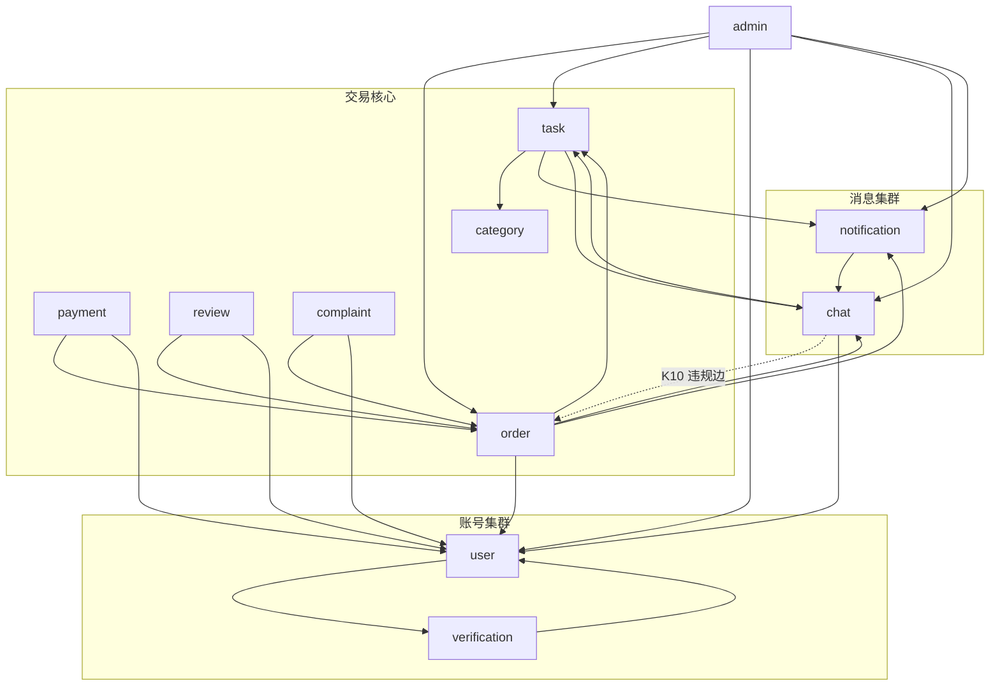

# CampusHub 架构文档

> 当前开发权威文档。课程历史交付物见 `docs/Course/`；模块边界与冻结接口见 [模块契约](模块契约.md)。
> 本文基于 2026-11 代码审查编写，引用格式为 `文件:行号`。

## 1. 项目概述

CampusHub 是校园互助与二手交易平台：用户发布需求（服务/二手/组队/辅导），服务方接单形成订单，验收后付款、结算、评价，信用分贯穿全程。课程项目，单体架构。

| 层 | 技术栈 | 说明 |
|---|---|---|
| 前端 | Vue 3 + Vite 5 + Element Plus + Pinia + Vue Router | 桌面端 SPA，`frontend/` |
| 后端 | Java 17 + Spring Boot 3.4 + Spring Data JPA | 单 Maven 模块，`backend/` |
| 数据库 | MySQL 8.0 | 时区统一 `Asia/Shanghai` |
| 认证 | JWT 无状态签名 | 不依赖 Redis，每请求回库校验用户状态 |
| 缓存 | Redis（spring-boot-starter-data-redis，Lettuce） | 仅完成依赖与连接配置，**业务代码尚未使用**，落地范围见 TODO §2.1 |
| 实时 | Spring WebSocket | 聊天与系统通知推送 |

## 2. 仓库结构

```
frontend/          Vue SPA（src 按业务域分目录）
backend/
  src/main/java/com/campushub/   按业务域分包 + 横切包
  SQL/             01 建库 → 02 账号表 → 03 交易核心表 → 04 消息表 → 05 测试数据；migrations/ 旧库升级
  private-storage/ 结算凭证（隐私文件，不对外静态映射）
docs/
  Course/          课程 P0–P4 历史交付物（只读存档）
  Engineer/        本文档 + 模块契约
AGENTS.md          开发纪律（契约神圣、提交规范等）
CONTRIBUTING.md    分支策略（main/user/admin/task/chat/redis）与合并纪律
```

## 3. 后端模块

| 模块 | 职责 | 关键类 | 出边依赖 |
|---|---|---|---|
| user | 账号、角色、信用分 | UserService（实现 UserDetailsService）、CreditService | verification |
| verification | 短信/邮箱验证码 | VerificationCodeService | user、util.MailService |
| task | 需求发布、审核、状态机 | TaskService；Task 多态子类 SecondHand/Teaming/Tutoring | category、user、chat、notification |
| order | 接单、取消、生命周期 | OrderService、OrderLifecycleService、OrderLocks | task、user、chat、notification、payment*、complaint* |
| payment | 支付、查单、人工结算 | PaymentService、PaymentTransactionService、SettlementService、FinanceController | order、user.CreditService、notification |
| review | 评价、7 天自动四星 | ReviewService、AutoReviewScheduler | order、user.CreditService、notification |
| complaint | 投诉、争议标记 | ComplaintService | order、user、notification |
| chat | 会话、消息、WebSocket | ConversationService、MessageService、ChatWebSocketHandler、ChatIntegrationService | task（实体）、user（只读） |
| notification | 站内通知 | NotificationService | chat（同事务双写） |
| admin | 后台监管聚合 | AdminService | **多个域的 repository（只读聚合）+ UserService/CreditService/TaskService 写入；仅分类增删改仍直写 categoryRepository** |
| category | 需求分类 | CategoryController | 无 |
| file | 文件上传 | FileController | 无 |

\* order 对 payment/complaint 的依赖是 OrderLifecycleService 里的全限定名 repository 直引（`OrderLifecycleService.java:24-25`），属深层耦合。

横切包（所有域共享，主干专属）：

- `common/`：ApiResponse{code,message,data}、PageResult、BusinessException、GlobalExceptionHandler
- `config/`：SecurityConfig（URL 授权白名单）、BusinessTimeConfig（全局 Clock + 调度开关）、WebConfig（uploads 静态映射）
- `security/`：JwtAuthenticationFilter
- `util/`：JwtUtil、UserContext（ThreadLocal 当前用户）、AesUtil、BcryptUtil、MailService

## 4. 模块依赖图



要点：

- **全仓库无事件总线/MQ，跨域协作全部是进程内同步调用，且多数在同一事务内。** 耦合本质是事务边界跨域，不是接口缺失。
- 交易核心（task/order/payment/review/complaint）业务高度重合，共享 Order 状态字段与"任务→订单"锁顺序（`OrderLocks.java:10`），不可再拆。
- user 是地基：出边仅 verification，但 User 实体与 UserRepository 被所有域引用。
- admin 曾是唯一越界直写者（K1，2026-11-16 已修复，仅剩分类增删改直写 categoryRepository）。
- 现存违规边：chat → order（K10）、order 直写用户状态（K9）。2026-11-20 已批准的修订（模块契约 §3.3、§3.4、§3.6）落地后，chat 只经 `TaskReadService` 读取交易核心，封禁统一经 `UserService.ban`。

## 5. 核心信息流

**交易流**：接单 `OrderService.acceptTask`（`OrderService.java:58`）同事务内：建订单 + 冻结金额与买卖方向（二手 SELL 时买家是接单人）+ 改 task 状态 + 调 ChatIntegrationService 建私聊/入群 + 发通知。支付回调 `PaymentTransactionService.recordVerified`（`PaymentTransactionService.java:66`）同事务内：更新支付单 + 改 Order 六个状态字段 + 撤销逾期误罚（查 CreditEvent 对账）+ 发通知。

**生命周期流**（定时扫描，全部 60s fixedDelay）：

| 扫描器 | 动作 |
|---|---|
| OrderDeadlineScheduler | 24h 自动验收、验收后 1h 付款期限、逾期扣 10 分、再 24h 升级管理员 |
| PaymentService.reconcilePending | 查单补偿丢失回调，未知结果只查单不伪造成功 |
| AutoReviewScheduler | 评价超 7 天默认四星（不加减信用分） |
| TaskAutoCancelScheduler | 过期需求自动取消 |
| GroupCleanupScheduler | 组队群清理 |
| CreditScoreScheduler | 信用分恢复 |

**通知流**：任何域 → `NotificationService.createNotification(receiverId, title, content, type)` → 同事务双写通知表 + chat 系统会话 → 前端 WebSocket 实时推送。

## 6. 前端结构

> 2026-11-19 起前端由 Frontend 分支统一维护，该分支已重做页面与共享组件（设计令牌、统一格式化与状态文案、管理后台布局），合入 main 后按新结构更新本节；下表为 main 现状。

| 目录 | 内容 | 跨模块引用 |
|---|---|---|
| task/ | 列表/详情/发布/表单等 7 组件 + taskApi | 详情页嵌 OrderActions、reviewApi；表单引 order/money |
| order/ | MyOrdersView、OrderActions、PaymentDialog + orderApi + orderPolicy + money | OrderActions 引 reviewApi/reviewDialog，直调 /complaints |
| chat/ | 10 组件 + chatApi + chatStore（WS 心跳/重连/乐观更新） | 仅 userStore，域内闭环 |
| admin/ | 6 管理页 + adminApi | 域内闭环，FinanceManagement 直调 /admin/finance |
| review/ | reviewApi + reviewDialog | 被 task/order 引用 |
| user/ | userStore（登录态/JWT/角色/信用分/受限标记） | 被 17 个文件引用，全站共享 |
| notification/ | notificationStore | 通知页解析 complaintId 跳 admin 路由 |
| views/ | LoginRegister、Profile、Notifications | — |
| common/ | httpClient（axios 工厂）、http（注入 token+报错）、ui/Pagination | 全站请求唯一入口 |
| router/ | index.js 单文件注册 16 条路由 + 全局守卫 | 新页面/新权限必改 |

共享热点：`App.vue` 三合一（导航菜单 + 全站 CSS 变量 + 聊天 WS 启停，`App.vue:122-165`）；`userStore.js` 会话字段变更需同步 persist/restoreSession。

## 7. 前后端分离与调用流程

**结构上完全分离**：独立构建、无共享代码、无 SSR。接缝仅三个：HTTP `/v1`、WS `/api/ws/chat`、静态文件 `/uploads`。契约手工对齐（无 OpenAPI/契约测试），外部 API 权威文档为 `docs/Course/P3/API规范文档.md`。

**HTTP 请求链**：

```
组件 → 模块api.js → common/http.js(注入JWT, ElMessage报错)
→ httpClient(baseURL=/v1, timeout=10s)
→ Vite代理: /v1 重写为 /api/v1 → localhost:8080
→ JwtAuthenticationFilter: 验token → SecurityContext + UserContext(ThreadLocal, finally清理)
→ SecurityConfig URL授权: 游客可读 tasks/categories/uploads;
  支付回调精确放行(SDK验签); 其余 ROLE_USER
→ Controller: UserContext.getCurrentUserId() 取身份(不信客户端自报)
→ Service → JPA → MySQL
→ ApiResponse{code,message,data}
→ 前端拦截器: HTTP 200 携带 code≥400 也 reject
```

身份链细节：UserService 实现 UserDetailsService（`UserService.java:25`），JWT 过滤器每请求回库加载用户——封禁即时生效，代价是每请求一次查库。

**WebSocket 链**：

```
App.vue watch登录态 → chatStore.connectWebSocket
→ ws://host/api/ws/chat?token=JWT  (浏览器WS不能加header, token走query)
→ Vite代理 ws:true → ChatWebSocketHandler.afterConnectionEstablished
→ 验token + 查账号 status=1 → sessions映射(userId→多端会话)
→ SEND/RECALL/PING → MessageService落库 → 按会话成员广播
```

HTTP 发消息同样实时推送：`ConversationController.java:75` 落库后调 `wsHandler.broadcastNewMessage`，两入口共用广播。心跳 30s，指数退避重连上限 16s/5 次。

**文件上传**：el-upload action 或原生 fetch → `POST /v1/files/upload` → FileController 落盘 uploads/ → 返回 URL。结算凭证走 `private-storage/settlements`，仅管理员鉴权接口下载，不对外静态映射。

**支付回调**（唯一外部入站）：渠道服务器 → `POST /v1/payments/notify/{wechat,alipay}`（permitAll，SDK 验签）→ 查单对账 → 同事务更新订单。

## 8. 运行时配置

| 项 | 值 | 位置 |
|---|---|---|
| 后端端口 / context-path | 8080 / `/api` | application.yml |
| 前端 dev 端口 | 5173 | vite.config.js:13 |
| 代理 | `/v1`→8080 重写加 `/api`；`/api`→8080 含 ws | vite.config.js:14-27 |
| 数据库 | MySQL 8，Asia/Shanghai | application.yml |
| Redis | `CAMPUSHUB_REDIS_HOST/PORT/PASSWORD`，默认 localhost:6379 无密码；连接懒建立，本地测试不需要 Redis 实例；CI 自带 Redis 服务并执行连通性检测 | application.yml、application-test.yml、RedisConnectivityTest |
| 静态文件 | uploads/ 公开映射；private-storage/ 鉴权下载 | WebConfig、SettlementEvidenceStorage |
| 测试 | application-test.yml 独立测试库、关闭调度；BusinessFixtures 跨域夹具；CommerceFlowIntegrationTest 跨 10 域端到端 | backend/src/test |
| 前端检查 | `npm run check` 全量编译 src 所有 vue/js；`npm test` 覆盖 httpClient 与 orderPolicy | scripts/check.mjs、test/ |

多实例并行需各自改端口（`--server.port` / `vite --port`）并同步代理目标；数据库建议每分支独立库名。

## 9. 已知问题（2026-11 审查）

> 各项最新修复进度以 [模块契约](模块契约.md) §9 为准，本表保留问题证据与影响。

| 编号 | 问题 | 证据 | 影响 |
|---|---|---|---|
| K1 | **已修复（2026-11-16）**：原 admin 写操作绕过域服务直写 repository，adjustCredit 无 CreditEvent 审计、无幂等。现封禁/调分/需求审核驳回删除均走域服务，调分支持可选 operationId 幂等。遗留：分类增删改仍直写 categoryRepository | 修复前证据：AdminService.java:153,166,234,251 | 已消除；遗留项待定 |
| K2 | notification→chat 同事务双写 | NotificationService.java:26 | 两域必须同集群开发 |
| K3 | ChatIntegrationService/ConversationService 收 Task 实体参数 | ChatIntegrationService.java:32 | chat 耦合 task 实体字段 |
| K4 | OrderLifecycleService 全限定名直引 payment/complaint repository | OrderLifecycleService.java:24-25 | 交易核心内部深耦合 |
| K5 | 前端 orderPolicy.js、orderFlow.js 复制后端规则（7 天窗口、24 小时验收、1 小时付款、逾期扣分），无同步机制 | orderPolicy.js:9、orderFlow.js（Frontend 分支） | 隐性契约，后端改规则前端悄悄错 |
| K6 | 5 处硬编码 http://localhost:8080 绕过代理（Frontend 分支 80f57aa 已修复，待合入） | userStore.js:9、TaskForm.vue:269、MessageBubble.vue:113、Profile.vue:136、ComplaintDetail.vue:17 | 部署即断 |
| K7 | 共享热点文件每加功能必改 | router/index.js、App.vue、SecurityConfig、userStore.js、httpClient.js | 并行冲突热点（多为追加型） |
| K8 | 部分上传绕过统一拦截器（Frontend 分支 80f57aa 已修复，待合入） | Profile.vue:75、MessageInput.vue:53、TaskForm.vue:272 | 错误语义不一致 |
| K9 | 交易核心直接写用户状态（逾期处罚封禁） | OrderLifecycleService.java:150 | 绕过账号集群的封禁规则与审计入口 |
| K10 | chat 依赖 order 判断群聊能否下线 | GroupCleanupScheduler.java:34,55-57 | 消息集群耦合订单状态机 |
| K11 | 控制器自拼错误响应，HTTP 200 携带错误码 | ConversationController.java:60,71,85、FileController.java:33,62 | 错误语义不一致，异常原文外泄 |
| K12 | 代码偏离外部 API 契约（校区必填、广场默认状态、关键词范围、评价公开查询） | TaskCreateRequest、TaskService.listTasks、SecurityConfig | 前端只能按实现兼容，契约失去约束力 |

## 10. 分支策略（2026-11 用户批准）

按功能竖切，不按层横切：契约变更发生在分支内部，分支间只依赖冻结接口。

| 分支 | 集群 | 范围 |
|---|---|---|
| main | 主干 | 整体文档、横切共享代码（见模块契约 §5 所有权表） |
| redis | 缓存扩展 | Redis 缓存与分布式锁落地（TODO §2.1） |
| user | 账号 | user + verification + file + 权限（security/SecurityConfig） |
| admin | 后台 | admin 后端（K1 已修复，写操作已改走域服务） |
| task | 交易核心 | task + order + payment + review + complaint + category，核心业务不再细分 |
| chat | 消息 | chat + notification（K2 双写决定必须同分支） |
| Frontend | 前端 | `frontend/` 全部（2026-11-19 设立；其余分支只改后端，接口变化时通知它） |

纪律：**未经许可不许合并**（含合入 main）；所有分支产生的文件一律在项目根目录内，不得延伸出去。

三个跨分支协调点：

1. **结构 ↔ 实体同步**：域内建表脚本随表归功能分支，全局件归 main，JPA 实体在各功能分支。结构变更与实体变更必须同批评审、同时合并，否则启动或运行即错。
2. **SecurityConfig 单点**：URL 授权白名单归 user 分支；任何分支新增端点需 user 分支同步白名单。
3. **admin 跨分支依赖**：admin 分支调用 task/user 分支的域服务（K1 已按此修复），接口以模块契约 §3 冻结版本为准。

后续开发方向：先修复模块间问题（K1–K8，见模块契约 §9），再做高并发与大数据量测试（TODO §4）。