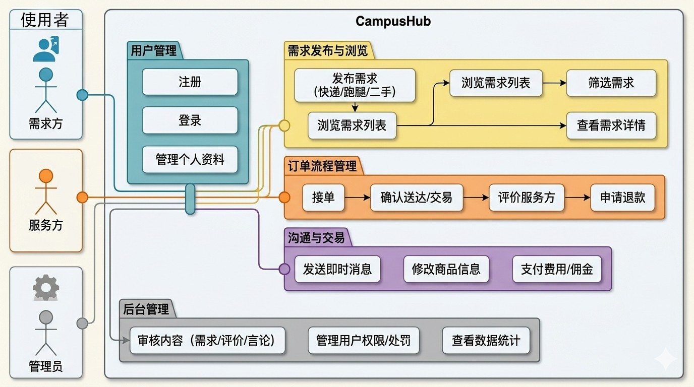

# 用例图

## 使用者

需求方、服务方、管理员。

## 功能

- 用户管理：注册、登录、管理个人资料。
- 需求发布与浏览：发布需求（快递/跑腿/二手）、浏览需求列表、筛选需求、查看需求详情。
- 订单流程管理：接单、确认送达/交易、评价服务方、申请退款。
- 沟通与交易：发送即时消息、修改商品信息、支付费用/佣金。
- 后台管理：审核内容（需求/评价/言论）、管理用户权限/处罚、查看数据统计。

