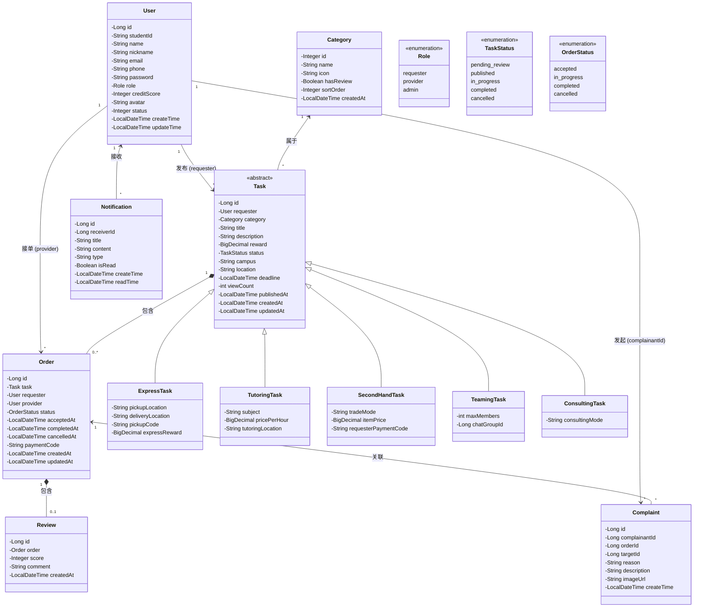

校园互助服务平台完整设计文档
目录
1.类图
2.API规范文档
3.数据库设计文档

一、类图



二、API规范文档
校园互助服务平台API规范文档
1.	通用规范

      URL路径：https://api.campus-help.com/v1
      
      字符编码：UTF-8
      
      认证方式：在请求头中携带 Authorization: Bearer <token>
      
      通用响应结构： 
       ①成功响应：


       {
       "code": 200,
       "message": "success",
       "data": { ... }
       }

②失败响应：
      
      {
      "code": 400,
      "message": "错误描述",
      "error": "详细错误信息"
      }

通用错误码：

      错误码	说明
      200	成功
      400	请求参数错误
      401	未认证/Token失效
      403	无权限
      404	资源不存在
      409	资源冲突
      422	参数校验失败
      429	请求过于频繁
      500	服务器内部错误
2.	接口详细定义

      2.1	用户注册

 
      项目	      说明
      URL	      /auth/register
      HTTP方法	  POST
      是否需要认证  否


    参数名	        类型	是否必填
    Student_id	String	是
    Phone	        String	是
    Password	String	是
    Nickname	String	是
    College	        String	否
    Real_name	string	否

响应格式：
①	成功响应：
      
    {
    "code": 200,
    "message": "success",
    "data": {
    "user_id": "123456",
    " student_id": "20240001",
    "nickname": "张三",
    "token": "eyJhbGciOiJIUzI1NiIs...",
    "expires_in": 7200
    }

②	失败响应：

    错误码	场景
    400	参数格式错误
    409	学号/手机号已注册
    422	参数校验失败

2.2	用户登录

    项目	说明
    URL	/auth/login
    HTTP方法	POST
    是否需要认证	否
请求参数：

    参数名	        类型	必填	说明
    Account   	String	是	学号/手机号
    password	string	是	密码

①	成功响应：

    {
    "code": 200,
    "message": "success",
    "data": {
    "user_id": "123456",
    "nickname": "张三",
    "avatar": "https://...",
    "token": "eyJhbGciOiJIUzI1NiIs...",
    "expires_in": 7200
    }
②	失败响应：

       错误码	场景
       400	      参数缺失
       401	    账号或密码错误
       429	    登录尝试次数过多

2.3	发布需求

    项目	说明
    URL	/demands
    HTTP方法	POST
    是否需要认证	是
请求参数：

     参数名	        类型	必填	说明
     Title	        string	是	需求标题
     Description	String	是	需求描述
      Category	String	是	分类
      Reward	Integer	否	报酬
      Deadline	String	是	截止时间
      Location	String	否	地点
      images	Array	否	图片URL列表
 Category枚举值：①二手交易 ②学习辅导 ③跑腿办事 ④咨询求助 ⑤其他

①	成功响应：

    {
    "code": 200,
    "message": "success",
    "data": {
    "demand_id": "dem_20240001",
    "status": "pending",
    "created_at": "2024-01-15T10:30:00Z"
    }

②	失败响应

    错误码	场景
    400	参数格式错误
    401	未认证
    422	校验失败
    429	发布过于频繁

2.4	浏览需求列表

    项目	说明
    URL	/demands
    HTTP方法	GET
    是否需要认证	否
请求参数：

    参数名	       类型	必填	说明
    Category	string	否	分类筛选
    Status	        String	否	状态筛选
    Page	        Integer	否	页码
    Page_size	Integer	否	每页数量
    Sort	        String	否	排列方式
    Keyword	        String	否	关键词搜索
    nearby	        Boolean	否	是否按距离排序
①	成功响应：

    {
     "code": 200,
      "message": "success",
      "data": {
       "items": [
      {
       "demand_id": "dem_20240001",
         "title": "帮忙取快递",
             "description": "韵达快递，包裹比较大",
         "category": "delivery",
         "reward": 10,
           "status": "pending",
        "location": "3号宿舍楼下",
        "distance": 0.5,
        "publisher": {
         "user_id": "123456",
          "nickname": "张三",
         "avatar": "https://..."
        },
       "created_at": "2024-01-15T10:30:00Z",
        "deadline": "2024-01-15T18:00:00Z"
        }
        ],
       "pagination": {
       "page": 1,
        "page_size": 20,
       "total": 45,
       "total_pages": 3
        }
        }
        }

2.5	接单

      项目	        说明
      URL	/demands/{demand_id}/accept
     HTTP方法	POST
    是否需要认证	是
请求参数：

      参数名	        类型	必填	说明
     Demand_id	string	是	需求ID
       message	String	否	接单留言，最多200字符
①	成功响应：

      {
      "code": 200,
      "message": "success",
      "data": {
      "demand_id": "dem_20240001",
      "status": "accepted",
      "helper_id": "789012",
      "accepted_at": "2024-01-15T10:35:00Z"
      }
      }
②	失败响应：

      错误码	场景
      400	请求无效
      401	未认证
      403	不能接自己的需求
      404	需求不存在
      409	需求已被他人接走
      409	需求已过期或已完成

2.6	查看接单详情

      项目	         说明
      URL	/orders/{order_id}
      HTTP方法	GET
      是否需要认证	是（仅发布者和接单者可见）
请求参数：

      参数名	          类型	必填	说明
      Order_id	String	是	订单ID
①	成功响应：

      {
      "code": 200,
      "message": "success",
      "data": {
      "order_id": "ord_20240001",
      "demand": {
      "demand_id": "dem_20240001",
      "title": "帮忙取快递",
      "description": "韵达快递，包裹比较大",
      "category": "delivery",
      "reward": 10,
      "deadline": "2024-01-15T18:00:00Z"
      },
      "publisher": {
      "user_id": "123456",
      "nickname": "张三",
      "avatar": "https://...",
      "phone": "138****0000"
      },
      "helper": {
      "user_id": "789012",
      "nickname": "李四",
      "avatar": "https://...",
      "phone": "139****0000"
      },
      "status": "accepted",
      "status_history": [
      { "status": "pending", "time": "2024-01-15T10:30:00Z" },
      { "status": "accepted", "time": "2024-01-15T10:35:00Z" }
      ],
      "evaluation": null,
      "created_at": "2024-01-15T10:30:00Z",
      "accepted_at": "2024-01-15T10:35:00Z",
      "completed_at": null
      }
      }
②	失败响应：

      错误码	场景
      401	未认证
      403	无权查看该订单
      404	订单不存在

2.7	提交评价

      项目	        说明
      URL	/orders/{order_id}/evaluation
      HTTP方法	POST
      是否需要认证	是（仅订单参与方）

请求参数：

      参数名	        类型	必填	说明
      Order_id	string	是	订单ID
      Rating	integer	是	评分
      Content	String	否	评价内容
      tags	         Array	否	标签
①	成功响应：

      {
      "code": 200,
      "message": "success",
      "data": {
      "evaluation_id": "eval_20240001",
      "rating": 5,
      "content": "非常准时，态度很好！",
      "tags": ["on_time", "kind"],
      "created_at": "2024-01-15T11:00:00Z"
      }
      }
②	失败响应：

      错误码	场景
      400	参数错误
      401	未认证
      403	无权评价该订单
      404	订单不存在
      409	订单未完成，无法评价
      409	已评价过


三、数据库设计
## 3.1 ER 图

### 3.1.1 核心实体识别

| 实体 | 说明 | 核心属性 |
|------|------|---------|
| **User** | 用户（含需求方、服务方、管理员三种角色） | id, name, email, phone, password_hash, role, credit_score, avatar, status |
| **Category** | 需求分类 | id, name, icon, has_review, sort_order |
| **Task** | 互助需求 | id, title, description, reward, status, location, deadline, published_at |
| **Order** | 订单 / 参与记录（用户与 Task 的连接） | id, status, accepted_at, completed_at, cancelled_at |
| **Review** | 评价 | id, score, comment, created_at |
| **Notification** | 消息通知 | id, type, content, is_read, created_at |

### 3.1.2 ER 图

```mermaid
erDiagram
    USERS ||--o{ TASKS : "发布 (requester_id)"
    USERS ||--o{ ORDERS : "作为需求方 (requester_id)"
    USERS ||--o{ ORDERS : "作为服务方 (provider_id)"
    USERS ||--o{ NOTIFICATIONS : "接收 (receiver_id)"
    USERS ||--o{ COMPLAINTS : "发起投诉 (complainant_id)"
    USERS ||--o{ COMPLAINTS : "被投诉 (target_id)"
    USERS ||--o{ CONVERSATION_MEMBERS : "成员 (user_id)"
    USERS ||--o{ CONVERSATIONS : "群主 (owner_id)"

    CATEGORIES ||--o{ TASKS : "分类 (category_id)"

    TASKS ||--|| T_TASK_RUNNING : "JOINED 继承 (task_id)"
    TASKS ||--|| T_TASK_TUTORING : "JOINED 继承 (task_id)"
    TASKS ||--|| T_TASK_FLEA : "JOINED 继承 (task_id)"
    TASKS ||--|| T_TASK_TEAM : "JOINED 继承 (task_id)"
    TASKS ||--|| T_TASK_CONSULTING : "JOINED 继承 (task_id)"
    TASKS ||--o{ ORDERS : "关联 (task_id)"
    TASKS ||--o{ CONVERSATIONS : "关联 (task_id)"

    ORDERS ||--o| REVIEWS : "被评价 (order_id)"
    ORDERS ||--o{ COMPLAINTS : "被投诉 (order_id)"

    CONVERSATIONS ||--o{ CONVERSATION_MEMBERS : "包含 (conv_id)"
    CONVERSATIONS ||--o{ MESSAGES : "包含 (conv_id)"

    USERS {
        bigint id PK "用户ID"
        varchar name "真实姓名"
        varchar email UK "学校邮箱"
        varchar phone UK "手机号(AES加密)"
        varchar password_hash "bcrypt哈希密码"
        enum role "requester/provider/admin"
        decimal credit_score "信用评分 默认5.0"
        varchar avatar "头像URL"
        tinyint status "1=正常 0=禁用"
        datetime created_at
        datetime updated_at
    }

    CATEGORIES {
        int id PK "分类ID"
        varchar name UK "分类名称"
        varchar icon "分类图标URL"
        tinyint has_review "是否支持评价"
        int sort_order "排序权重"
        datetime created_at
    }

    TASKS {
        bigint id PK "需求ID"
        bigint requester_id FK "发布者"
        int category_id FK "分类ID"
        varchar task_type "RUNNING/TUTORING/FLEA/TEAM/CONSULTING"
        varchar title "需求标题"
        varchar description "详细描述"
        decimal reward "报酬金额"
        enum campus "鼓楼/仙林/浦口/苏州"
        enum status "pending_review/published/in_progress/completed/cancelled"
        varchar location "地点"
        datetime deadline "截止时间"
        int view_count "浏览量"
        datetime published_at "发布时间"
        datetime created_at
        datetime updated_at
    }

    T_TASK_RUNNING {
        bigint task_id PK "PK,FK→tasks"
        varchar pickup_location "取货地点"
        varchar delivery_location "送达地点"
        varchar pickup_code "取件码"
        decimal sub_reward "跑腿报酬"
    }

    T_TASK_TUTORING {
        bigint task_id PK "PK,FK→tasks"
        varchar subject "辅导科目"
        decimal price_per_hour "时薪"
        varchar tutoring_location "辅导地点"
    }

    T_TASK_FLEA {
        bigint task_id PK "PK,FK→tasks"
        decimal item_price "物品售价"
        varchar item_condition "物品成色"
    }

    T_TASK_TEAM {
        bigint task_id PK "PK,FK→tasks"
        int max_members "成团人数上限"
        bigint chat_group_id "关联群聊ID"
    }

    T_TASK_CONSULTING {
        bigint task_id PK "PK,FK→tasks"
        varchar consulting_mode "ONLINE/OFFLINE"
    }

    ORDERS {
        bigint id PK "订单ID"
        bigint task_id FK "关联需求"
        bigint requester_id FK "需求方ID"
        bigint provider_id FK "服务方ID"
        enum status "accepted/in_progress/completed/cancelled"
        datetime accepted_at "接单时间"
        datetime completed_at "完成时间"
        datetime cancelled_at "取消时间"
        datetime created_at
        datetime updated_at
    }

    REVIEWS {
        bigint id PK "评价ID"
        bigint order_id UK "UK,FK→orders"
        tinyint score "评分 1-5"
        varchar comment "评价内容"
        datetime created_at
    }

    NOTIFICATIONS {
        bigint id PK "通知ID"
        bigint receiver_id FK "接收者"
        varchar type "通知类型"
        varchar title "通知标题"
        text content "通知内容"
        tinyint is_read "是否已读"
        datetime created_at
    }

    COMPLAINTS {
        bigint id PK "投诉ID"
        bigint complainant_id FK "投诉人"
        bigint order_id FK "关联订单"
        bigint target_id FK "被投诉人"
        varchar reason "投诉理由"
        varchar description "详细描述"
        varchar image_url "证据图片URL"
        datetime create_time
    }

    VERIFICATION_CODES {
        bigint id PK "验证码ID"
        varchar phone "手机号"
        varchar code "验证码"
        varchar type "REGISTER/LOGIN/BIND"
        datetime expire_time "过期时间"
        tinyint used "是否已使用"
        datetime create_time
    }

    CONVERSATIONS {
        bigint id PK "会话ID"
        varchar conv_type "TASK_PRIVATE/TEAM_GROUP/SYSTEM_NOTIFY"
        bigint task_id FK "关联需求"
        bigint order_id FK "关联订单"
        varchar group_name "群名称"
        bigint owner_id FK "群主ID"
        int max_members "人数上限"
        tinyint keep_group "是否保留群聊"
        datetime keep_asked_at "保留询问时间"
        datetime created_at
        datetime updated_at
    }

    CONVERSATION_MEMBERS {
        bigint id PK
        bigint conv_id FK "会话ID"
        bigint user_id FK "成员ID"
        enum role "OWNER/MEMBER"
        datetime joined_at
    }

    MESSAGES {
        bigint id PK "消息ID"
        bigint conv_id FK "所属会话"
        bigint sender_id "发送者(0=系统)"
        enum msg_type "TEXT/SYSTEM/IMAGE"
        text content "消息内容"
        tinyint is_recalled "是否撤回"
        datetime created_at
    }
```



### 3.1.3 实体关系说明

| 关系 | 基数 | 说明 |
|------|:---:|------|
| User → Task（发布） | **1 : N** | 一个需求方发布多个需求 |
| User → Order（需求方） | **1 : N** | 一个需求方产生多个订单 |
| User → Order（服务方） | **1 : N** | 一个服务方接多个订单 |
| User → Notification | **1 : N** | 一个用户接收多条通知 |
| User → Complaint（发起） | **1 : N** | 一个用户发起多条投诉 |
| User → Conversation（群主） | **1 : N** | 一个用户可创建多个群聊 |
| User → ConversationMember | **1 : N** | 一个用户可加入多个会话 |
| Category → Task | **1 : N** | 一个分类下有多个需求 |
| Task → 子表（5 类） | **1 : 1** | JOINED 继承，每个 Task 对应唯一子类记录 |
| Task → Order | **1 : N** | 一个需求可有多个订单/参与 |
| Task → Conversation | **1 : N** | 一个需求可关联多个会话 |
| Order → Review | **1 : 0..1** | 一个订单最多一条评价 |
| Order → Complaint | **1 : N** | 一个订单可被多次投诉 |
| Conversation → ConversationMember | **1 : N** | 一个会话有多个成员 |
| Conversation → Message | **1 : N** | 一个会话包含多条消息 |

### 3.1.4 主键与外键汇总

| 表名 | 主键 (PK) | 外键 (FK) |
|------|----------|----------|
| users | `id` | — |
| categories | `id` | — |
| tasks | `id` | `requester_id` → users, `category_id` → categories |
| t_task_running | `task_id` | → tasks (CASCADE) |
| t_task_tutoring | `task_id` | → tasks (CASCADE) |
| t_task_flea | `task_id` | → tasks (CASCADE) |
| t_task_team | `task_id` | → tasks (CASCADE) |
| t_task_consulting | `task_id` | → tasks (CASCADE) |
| orders | `id` | `task_id` → tasks, `requester_id` → users, `provider_id` → users |
| reviews | `id` | `order_id` → orders (UK) |
| notifications | `id` | `receiver_id` → users |
| complaints | `id` | `complainant_id` → users, `order_id` → orders, `target_id` → users |
| verification_codes | `id` | — |
| conversations | `id` | `task_id` → tasks, `owner_id` → users |
| conversation_members | `id` | `conv_id` → conversations (CASCADE), `user_id` → users |
| messages | `id` | `conv_id` → conversations (CASCADE) |

---

## 3.2 建表 SQL

### 3.2.1 数据库与字符集

```sql
CREATE DATABASE IF NOT EXISTS campushub
  DEFAULT CHARACTER SET utf8mb4
  DEFAULT COLLATE utf8mb4_unicode_ci;

USE campushub;
```

### 3.2.2 用户表 `users`

```sql
CREATE TABLE users (
    id              BIGINT          NOT NULL AUTO_INCREMENT  COMMENT '用户ID',
    name            VARCHAR(20)     NOT NULL                 COMMENT '真实姓名',
    email           VARCHAR(100)    NOT NULL                 COMMENT '学校邮箱',
    phone           VARCHAR(255)    NOT NULL                 COMMENT '手机号（AES加密存储）',
    password_hash   VARCHAR(255)    NOT NULL                 COMMENT 'bcrypt哈希密码',
    role            ENUM('requester','provider','admin')
                                    NOT NULL                 COMMENT '用户角色',
    credit_score    DECIMAL(3,1)    NOT NULL DEFAULT 5.0     COMMENT '信用评分',
    avatar          VARCHAR(500)    DEFAULT NULL             COMMENT '头像URL',
    status          TINYINT(1)      NOT NULL DEFAULT 1       COMMENT '状态：1=正常, 0=禁用',
    created_at      DATETIME        NOT NULL DEFAULT CURRENT_TIMESTAMP,
    updated_at      DATETIME        NOT NULL DEFAULT CURRENT_TIMESTAMP ON UPDATE CURRENT_TIMESTAMP,
    PRIMARY KEY (id),
    UNIQUE KEY uk_email (email),
    UNIQUE KEY uk_phone (phone)
) ENGINE=InnoDB DEFAULT CHARSET=utf8mb4 COLLATE=utf8mb4_unicode_ci COMMENT='用户表';
```

### 3.2.3 需求分类表 `categories`

```sql
CREATE TABLE categories (
    id              INT             NOT NULL AUTO_INCREMENT  COMMENT '分类ID',
    name            VARCHAR(20)     NOT NULL                 COMMENT '分类名称',
    icon            VARCHAR(255)    DEFAULT NULL             COMMENT '分类图标URL',
    has_review      TINYINT(1)      NOT NULL DEFAULT 0       COMMENT '是否支持评价：1=支持, 0=不支持',
    sort_order      INT             NOT NULL DEFAULT 0       COMMENT '排序权重',
    created_at      DATETIME        NOT NULL DEFAULT CURRENT_TIMESTAMP,
    PRIMARY KEY (id),
    UNIQUE KEY uk_name (name)
) ENGINE=InnoDB DEFAULT CHARSET=utf8mb4 COLLATE=utf8mb4_unicode_ci COMMENT='需求分类表';
```
 

### 3.2.4 需求表 `tasks`

```sql
CREATE TABLE tasks (
    id              BIGINT          NOT NULL AUTO_INCREMENT  COMMENT '需求ID/基类主键',
    requester_id    BIGINT          NOT NULL                 COMMENT '发布者ID',
    category_id     INT             NOT NULL                 COMMENT '分类ID',
    task_type       VARCHAR(20)     NOT NULL                 COMMENT '多态辨别者：RUNNING/TUTORING/FLEA/TEAM/CONSULTING',
    title           VARCHAR(50)     NOT NULL                 COMMENT '需求标题',
    description     VARCHAR(500)    NOT NULL                 COMMENT '详细描述',
    reward          DECIMAL(10,2)   DEFAULT NULL             COMMENT '报酬金额（基类保留，向后兼容）',
    campus          ENUM('鼓楼校区','仙林校区','浦口校区','苏州校区')
                                    DEFAULT NULL             COMMENT '所属校区',
    status          ENUM('pending_review','published','in_progress','completed','cancelled')
                                    NOT NULL DEFAULT 'pending_review' COMMENT '需求状态',
    location        VARCHAR(100)    DEFAULT NULL             COMMENT '地点（基类保留，向后兼容）',
    deadline        DATETIME        DEFAULT NULL             COMMENT '截止时间',
    view_count      INT             NOT NULL DEFAULT 0       COMMENT '浏览量',
    published_at    DATETIME        NOT NULL DEFAULT CURRENT_TIMESTAMP COMMENT '发布时间',
    created_at      DATETIME        NOT NULL DEFAULT CURRENT_TIMESTAMP,
    updated_at      DATETIME        NOT NULL DEFAULT CURRENT_TIMESTAMP ON UPDATE CURRENT_TIMESTAMP,
    PRIMARY KEY (id),
    KEY idx_requester_id (requester_id),
    KEY idx_category_id (category_id),
    KEY idx_status (status),
    KEY idx_published_at (published_at),
    KEY idx_task_type (task_type),
    CONSTRAINT fk_task_requester FOREIGN KEY (requester_id) REFERENCES users(id),
    CONSTRAINT fk_task_category  FOREIGN KEY (category_id)  REFERENCES categories(id)
) ENGINE=InnoDB DEFAULT CHARSET=utf8mb4 COLLATE=utf8mb4_unicode_ci COMMENT='需求基础表（父类）';
```

### 3.2.5 需求子表（JOINED 继承）

**跑腿服务 ExpressTask**

```sql
CREATE TABLE t_task_running (
    task_id          BIGINT          PRIMARY KEY              COMMENT '关联tasks表id',
    pickup_location  VARCHAR(100)    NOT NULL                 COMMENT '出发/取货地点',
    delivery_location VARCHAR(100)   NOT NULL                 COMMENT '送达/目的地',
    pickup_code      VARCHAR(50)     DEFAULT NULL             COMMENT '取件码/备注信息',
    sub_reward       DECIMAL(10,2)   NOT NULL                 COMMENT '跑腿费报酬',
    FOREIGN KEY (task_id) REFERENCES tasks(id) ON DELETE CASCADE
) ENGINE=InnoDB DEFAULT CHARSET=utf8mb4 COLLATE=utf8mb4_unicode_ci COMMENT='跑腿服务专属表';
```

**学习辅导 TutoringTask**

```sql
CREATE TABLE t_task_tutoring (
    task_id          BIGINT          PRIMARY KEY              COMMENT '关联tasks表id',
    subject          VARCHAR(50)     NOT NULL                 COMMENT '辅导科目',
    price_per_hour   DECIMAL(10,2)   NOT NULL                 COMMENT '时薪报酬',
    tutoring_location VARCHAR(100)   NOT NULL                 COMMENT '辅导地点',
    FOREIGN KEY (task_id) REFERENCES tasks(id) ON DELETE CASCADE
) ENGINE=InnoDB DEFAULT CHARSET=utf8mb4 COLLATE=utf8mb4_unicode_ci COMMENT='学习辅导专属表';
```

**二手交易 SecondHandTask**

```sql
CREATE TABLE t_task_flea (
    task_id          BIGINT          PRIMARY KEY              COMMENT '关联tasks表id',
    item_price       DECIMAL(10,2)   NOT NULL                 COMMENT '物品售价',
    item_condition   VARCHAR(20)     NOT NULL DEFAULT '九成新' COMMENT '物品成色',
    FOREIGN KEY (task_id) REFERENCES tasks(id) ON DELETE CASCADE
) ENGINE=InnoDB DEFAULT CHARSET=utf8mb4 COLLATE=utf8mb4_unicode_ci COMMENT='二手交易专属表';
```

**活动组队 TeamingTask**

```sql
CREATE TABLE t_task_team (
    task_id          BIGINT          PRIMARY KEY              COMMENT '关联tasks表id',
    max_members      INT             NOT NULL DEFAULT 2       COMMENT '成团人数上限',
    chat_group_id    BIGINT          DEFAULT NULL             COMMENT '关联群聊ID（预留）',
    FOREIGN KEY (task_id) REFERENCES tasks(id) ON DELETE CASCADE
) ENGINE=InnoDB DEFAULT CHARSET=utf8mb4 COLLATE=utf8mb4_unicode_ci COMMENT='活动组队专属表';
```

**信息咨询 ConsultingTask**

```sql
CREATE TABLE t_task_consulting (
    task_id          BIGINT          PRIMARY KEY              COMMENT '关联 tasks id',
    consulting_mode  VARCHAR(20)     NOT NULL DEFAULT 'ONLINE' COMMENT '咨询方式: ONLINE/OFFLINE',
    FOREIGN KEY (task_id) REFERENCES tasks(id) ON DELETE CASCADE
) ENGINE=InnoDB DEFAULT CHARSET=utf8mb4 COLLATE=utf8mb4_unicode_ci COMMENT='信息咨询任务表';
```

### 3.2.6 订单表 `orders`

```sql
CREATE TABLE orders (
    id              BIGINT          NOT NULL AUTO_INCREMENT  COMMENT '订单ID',
    task_id         BIGINT          NOT NULL                 COMMENT '关联需求ID',
    requester_id    BIGINT          NOT NULL                 COMMENT '需求方ID',
    provider_id     BIGINT          NOT NULL                 COMMENT '服务方/参与者ID',
    status          ENUM('accepted','in_progress','completed','cancelled')
                                    NOT NULL DEFAULT 'accepted' COMMENT '订单状态',
    accepted_at     DATETIME        NOT NULL DEFAULT CURRENT_TIMESTAMP COMMENT '接单/参与时间',
    completed_at    DATETIME        DEFAULT NULL             COMMENT '完成时间',
    cancelled_at    DATETIME        DEFAULT NULL             COMMENT '取消时间',
    created_at      DATETIME        NOT NULL DEFAULT CURRENT_TIMESTAMP,
    updated_at      DATETIME        NOT NULL DEFAULT CURRENT_TIMESTAMP ON UPDATE CURRENT_TIMESTAMP,
    PRIMARY KEY (id),
    KEY idx_task_id (task_id),
    KEY idx_requester_id (requester_id),
    KEY idx_provider_id (provider_id),
    KEY idx_status (status),
    CONSTRAINT fk_order_task      FOREIGN KEY (task_id)      REFERENCES tasks(id),
    CONSTRAINT fk_order_requester FOREIGN KEY (requester_id) REFERENCES users(id),
    CONSTRAINT fk_order_provider  FOREIGN KEY (provider_id)  REFERENCES users(id)
) ENGINE=InnoDB DEFAULT CHARSET=utf8mb4 COLLATE=utf8mb4_unicode_ci COMMENT='订单/参与记录表';
```

### 3.2.7 评价表 `reviews`

```sql
CREATE TABLE reviews (
    id              BIGINT          NOT NULL AUTO_INCREMENT  COMMENT '评价ID',
    order_id        BIGINT          NOT NULL                 COMMENT '关联订单ID',
    score           TINYINT         NOT NULL                 COMMENT '评分，1-5',
    comment         VARCHAR(200)    DEFAULT NULL             COMMENT '评价内容',
    created_at      DATETIME        NOT NULL DEFAULT CURRENT_TIMESTAMP,
    PRIMARY KEY (id),
    UNIQUE KEY uk_order_id (order_id),
    CONSTRAINT fk_review_order FOREIGN KEY (order_id) REFERENCES orders(id),
    CONSTRAINT chk_score CHECK (score >= 1 AND score <= 5)
) ENGINE=InnoDB DEFAULT CHARSET=utf8mb4 COLLATE=utf8mb4_unicode_ci COMMENT='评价表';
```

### 3.2.8 通知表 `notifications`

```sql
CREATE TABLE notifications (
    id              BIGINT          NOT NULL AUTO_INCREMENT  COMMENT '通知ID',
    receiver_id     BIGINT          NOT NULL                 COMMENT '接收者ID',
    type            VARCHAR(30)     NOT NULL                 COMMENT '通知类型',
    title           VARCHAR(100)    NOT NULL                 COMMENT '通知标题',
    content         TEXT            NOT NULL                 COMMENT '通知内容',
    is_read         TINYINT(1)      NOT NULL DEFAULT 0       COMMENT '是否已读',
    created_at      DATETIME        NOT NULL DEFAULT CURRENT_TIMESTAMP,
    PRIMARY KEY (id),
    KEY idx_receiver_read (receiver_id, is_read),
    KEY idx_created_at (created_at),
    CONSTRAINT fk_notification_receiver FOREIGN KEY (receiver_id) REFERENCES users(id)
) ENGINE=InnoDB DEFAULT CHARSET=utf8mb4 COLLATE=utf8mb4_unicode_ci COMMENT='通知表';
```

### 3.2.9 投诉表 `complaints`

```sql
CREATE TABLE complaints (
    id              BIGINT          NOT NULL AUTO_INCREMENT COMMENT '投诉ID',
    complainant_id  BIGINT          NOT NULL                COMMENT '投诉发起人ID',
    order_id        BIGINT          NOT NULL                COMMENT '被投诉订单ID',
    target_id       BIGINT          NOT NULL                COMMENT '被投诉人ID',
    reason          VARCHAR(100)    NOT NULL                COMMENT '投诉理由',
    description     VARCHAR(500)    DEFAULT NULL            COMMENT '详细描述',
    image_url       VARCHAR(500)    DEFAULT NULL            COMMENT '证据图片URL',
    create_time     DATETIME(6)     DEFAULT NULL,
    PRIMARY KEY (id),
    KEY idx_order_id (order_id),
    CONSTRAINT fk_complaint_order FOREIGN KEY (order_id) REFERENCES orders(id)
) ENGINE=InnoDB DEFAULT CHARSET=utf8mb4 COLLATE=utf8mb4_unicode_ci COMMENT='投诉表';
```

### 3.2.10 验证码表 `verification_codes`

```sql
CREATE TABLE verification_codes (
    id              BIGINT          NOT NULL AUTO_INCREMENT  COMMENT '验证码ID',
    phone           VARCHAR(11)     NOT NULL                 COMMENT '手机号',
    code            VARCHAR(6)      NOT NULL                 COMMENT '验证码',
    type            VARCHAR(20)     NOT NULL                 COMMENT '类型：REGISTER/LOGIN/BIND',
    expire_time     DATETIME        NOT NULL                 COMMENT '过期时间',
    used            TINYINT(1)      NOT NULL DEFAULT 0       COMMENT '是否已使用',
    create_time     DATETIME        NOT NULL DEFAULT CURRENT_TIMESTAMP,
    PRIMARY KEY (id)
) ENGINE=InnoDB DEFAULT CHARSET=utf8mb4 COLLATE=utf8mb4_unicode_ci COMMENT='验证码表';
```

### 3.2.11 会话表 `conversations`

```sql
CREATE TABLE conversations (
    id              BIGINT          NOT NULL AUTO_INCREMENT  COMMENT '会话ID',
    conv_type       VARCHAR(20)     NOT NULL                 COMMENT 'TASK_PRIVATE / TEAM_GROUP / SYSTEM_NOTIFY',
    task_id         BIGINT          DEFAULT NULL             COMMENT '关联需求ID（系统通知为NULL）',
    order_id        BIGINT          DEFAULT NULL             COMMENT '关联订单ID',
    group_name      VARCHAR(50)     DEFAULT NULL             COMMENT '群名称',
    owner_id        BIGINT          DEFAULT NULL             COMMENT '群主ID',
    max_members     INT             DEFAULT NULL             COMMENT '人数上限',
    keep_group      TINYINT(1)      DEFAULT NULL             COMMENT '是否保留群聊',
    keep_asked_at   DATETIME        DEFAULT NULL             COMMENT '保留询问时间',
    created_at      DATETIME        NOT NULL DEFAULT CURRENT_TIMESTAMP,
    updated_at      DATETIME        NOT NULL DEFAULT CURRENT_TIMESTAMP ON UPDATE CURRENT_TIMESTAMP,
    PRIMARY KEY (id),
    KEY idx_task_id (task_id),
    KEY idx_conv_type (conv_type),
    CONSTRAINT fk_conv_owner FOREIGN KEY (owner_id) REFERENCES users(id)
) ENGINE=InnoDB DEFAULT CHARSET=utf8mb4 COLLATE=utf8mb4_unicode_ci COMMENT='会话表';
```

### 3.2.12 会话成员表 `conversation_members`

```sql
CREATE TABLE conversation_members (
    id              BIGINT          NOT NULL AUTO_INCREMENT,
    conv_id         BIGINT          NOT NULL                 COMMENT '会话ID',
    user_id         BIGINT          NOT NULL                 COMMENT '成员ID',
    role            ENUM('OWNER','MEMBER') NOT NULL DEFAULT 'MEMBER',
    joined_at       DATETIME        NOT NULL DEFAULT CURRENT_TIMESTAMP,
    PRIMARY KEY (id),
    UNIQUE KEY uk_conv_user (conv_id, user_id),
    FOREIGN KEY (conv_id) REFERENCES conversations(id) ON DELETE CASCADE,
    FOREIGN KEY (user_id) REFERENCES users(id)
) ENGINE=InnoDB DEFAULT CHARSET=utf8mb4 COLLATE=utf8mb4_unicode_ci COMMENT='会话成员';
```

### 3.2.13 消息表 `messages`

```sql
CREATE TABLE messages (
    id              BIGINT          NOT NULL AUTO_INCREMENT  COMMENT '消息ID',
    conv_id         BIGINT          NOT NULL                 COMMENT '所属会话',
    sender_id       BIGINT          NOT NULL                 COMMENT '发送者（0=系统）',
    msg_type        ENUM('TEXT','SYSTEM','IMAGE') NOT NULL DEFAULT 'TEXT',
    content         TEXT            NOT NULL                 COMMENT '消息内容',
    is_recalled     TINYINT(1)      NOT NULL DEFAULT 0       COMMENT '是否撤回',
    created_at      DATETIME        NOT NULL DEFAULT CURRENT_TIMESTAMP,
    PRIMARY KEY (id),
    KEY idx_conv_created (conv_id, created_at),
    FOREIGN KEY (conv_id) REFERENCES conversations(id) ON DELETE CASCADE
) ENGINE=InnoDB DEFAULT CHARSET=utf8mb4 COLLATE=utf8mb4_unicode_ci COMMENT='消息表';
```

### 3.2.14 索引设计说明

| 表 | 索引 | 类型 | 设计理由 |
|------|------|------|---------|
| users | `uk_email` | UNIQUE | 登录查找 + 保证唯一 |
| users | `uk_phone` | UNIQUE | 手机号登录 + 保证唯一 |
| categories | `uk_name` | UNIQUE | 分类名唯一 |
| tasks | `idx_requester_id` | INDEX | "我的发布"列表高频查询 |
| tasks | `idx_category_id` | INDEX | 首页分类筛选 |
| tasks | `idx_status` | INDEX | 按状态过滤（审核/发布/进行中） |
| tasks | `idx_published_at` | INDEX | 首页按时间排序 |
| tasks | `idx_task_type` | INDEX | 按任务类型筛选 |
| orders | `idx_task_id` | INDEX | 查某需求的所有订单/参与者 |
| orders | `idx_requester_id` | INDEX | 需求方"我的订单" |
| orders | `idx_provider_id` | INDEX | 服务方"我的接单" |
| orders | `idx_status` | INDEX | 按订单状态筛选 |
| reviews | `uk_order_id` | UNIQUE | 一个订单最多一条评价 |
| notifications | `idx_receiver_read` | 复合 | 查某用户未读通知（最高频） |
| notifications | `idx_created_at` | INDEX | 通知列表按时间排序 |
| complaints | `idx_order_id` | INDEX | 查某订单的投诉记录 |
| conversations | `idx_task_id` | INDEX | 查某需求的关联会话 |
| conversations | `idx_conv_type` | INDEX | 按会话类型筛选 |
| conversation_members | `uk_conv_user` | UNIQUE | 同一用户不能重复加入同会话 |
| messages | `idx_conv_created` | 复合 | 拉取会话消息历史（最高频） |

### 3.2.15 隐私数据处理

| 敏感字段 | 存储方式 | 说明 |
|---------|---------|------|
| **密码** | bcrypt 加盐哈希 | `BCryptPasswordEncoder`，cost factor = 10，永不明文存储 |
| **手机号** | AES-256 加密 | 数据库存密文，API 返回脱敏（`138****1234`），密钥通过 `application.yml` 注入 |
| **JWT Token** | HMAC-SHA512 签名 | `jwt.secret` 至少 512 位，`expiration` 24 小时 |


| orders | `idx_status` | 普通索引 | 按订单状态筛选 |
| reviews | `uk_order_id` | 唯一索引 | 一个订单最多一条评价 |
| notifications | `idx_receiver_read` | 复合索引 | 查某用户的未读通知（高频） |
| notifications | `idx_created_at` | 普通索引 | 通知列表按时间排序 |

### 3.2.9 隐私数据处理

| 敏感字段 | 存储方式 | 说明 |
|---------|---------|------|
| **密码** | bcrypt 加盐哈希 | `BCryptPasswordEncoder`，cost factor = 10，永不明文存储 |
| **手机号** | AES-256 加密 | 数据库存密文，API 返回脱敏（`138****1234`），密钥由环境变量注入 |


