# 演示说明

第一步：打开backend/SQL 运行三个.sql 文件建立数据库。

第二步：打开backend/src/main/java/com.campusub,运行CampusHubApplication 文件启动后端，控制台弹出输出日志文件表明启动成功。

第三步：在终端项目文件下运行：

```powershell
cd frontend;
npm install;
npm run dev
```

启动前端，进入终端给出的网站，页面如下

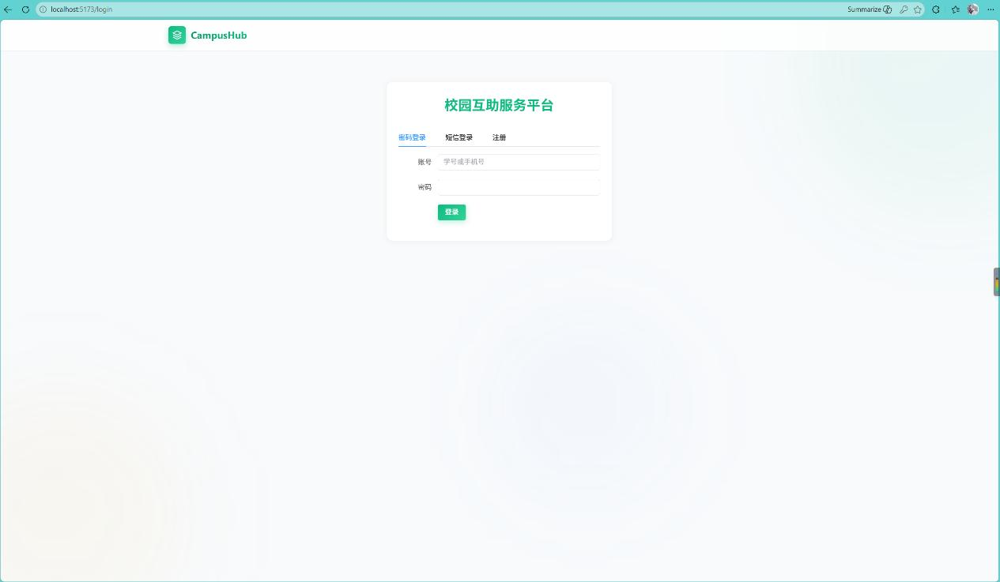

第四步：注册账号，注册页面如下：

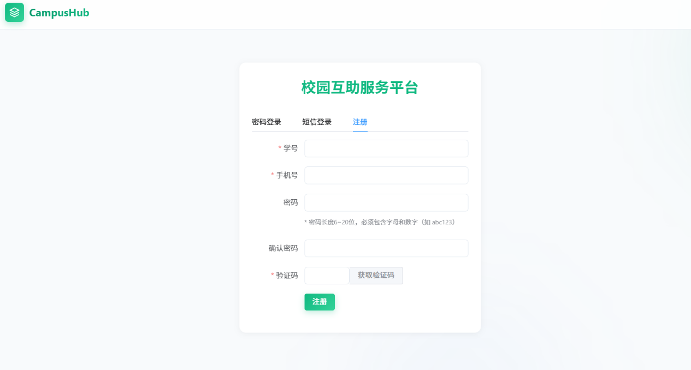

第五步：注册后弹出“注册成功”后登录已注册的账号，进入主页面，同时本地数据库也给出了测试账号，可在03-init-data.sql 中查看学号和密码。主页面如图：

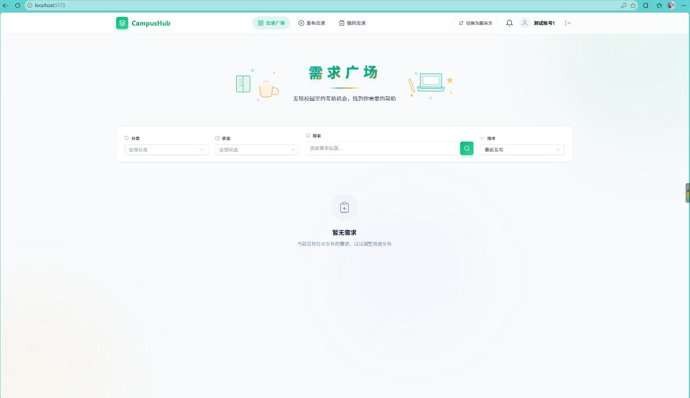

每一个用户都可以选择在服务方和需求方之间切换，既能发布需求，也能接单。

用户界面如图：

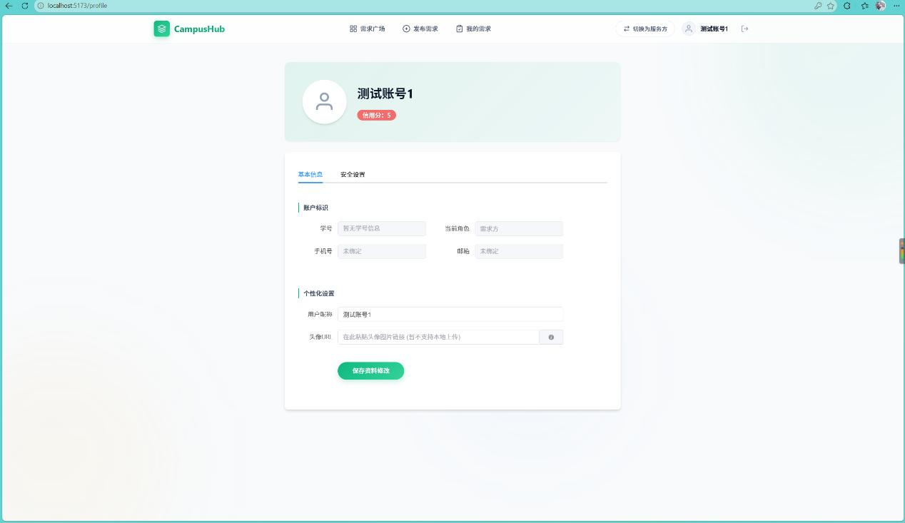

实际注册新用户默认初始信用分为100.安全设置内可修改密码。

下面演示需求方和服务方核心功能。

需求方关于需求发布：

1. 点击“发布需求”，页面如下：

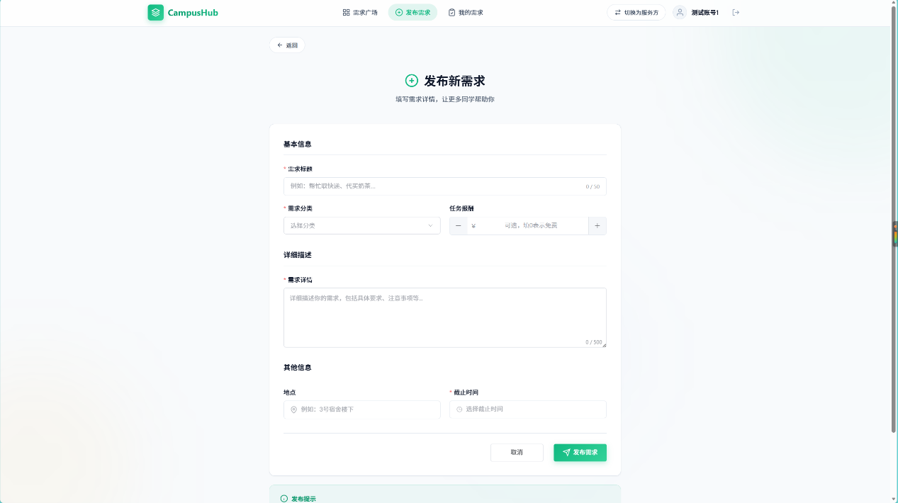

可选择设置金额和需求类型，包括：快递代取，学习辅导，二手交易，组队匹配。需求发布后会在主页面，即需求广场显示：

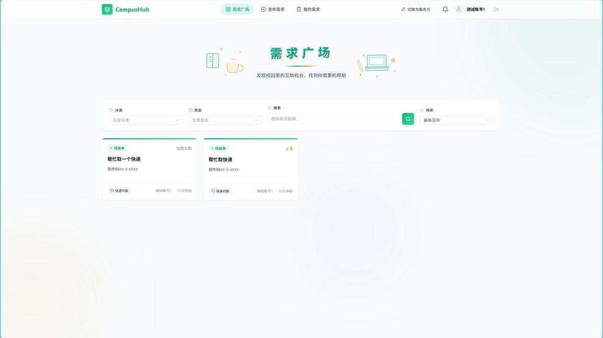

可根据个人情况分类寻找相关需求，需求页面打开后显示如图：

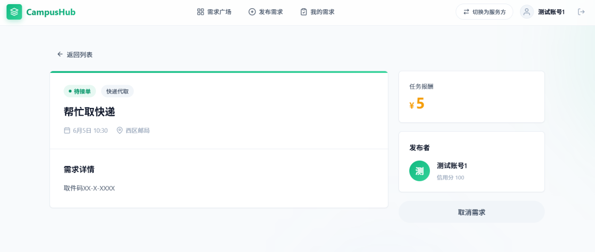

非本人查看需求情况下不会显示取消需求，被接单后该按钮会置灰无法点击。

下面演示服务方核心功能：

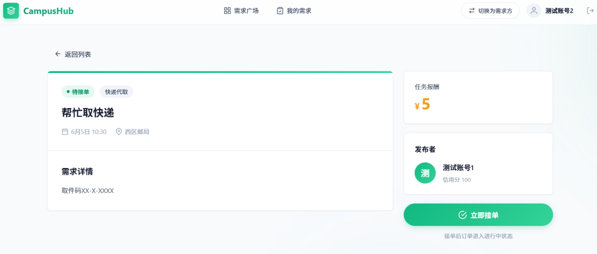

在需求广场任选一个进入即可看到接单按钮，如果为有偿任务，则会弹出上传支付方式的页面：

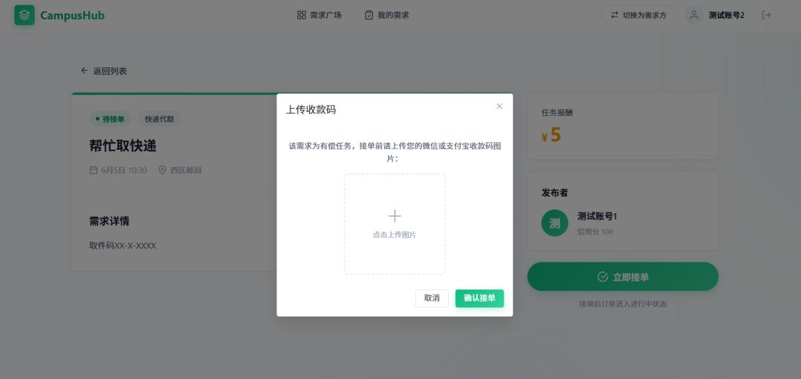

接单完成后会变成如下情况：

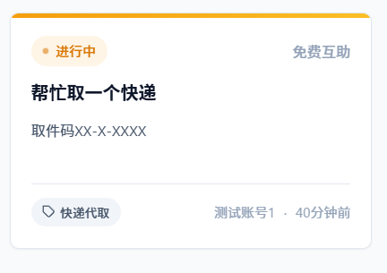

同时在需求方和服务方的“我的需求”界面也会显示已经被接单和已经接单的需求，此时需求方的需求页面会变成：

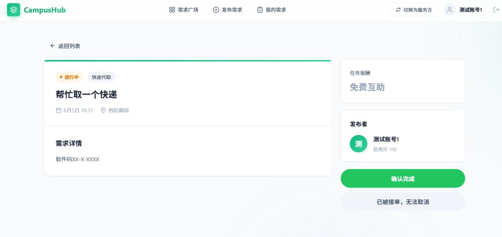

当确认需求被完成后，可进行对服务方的评价：

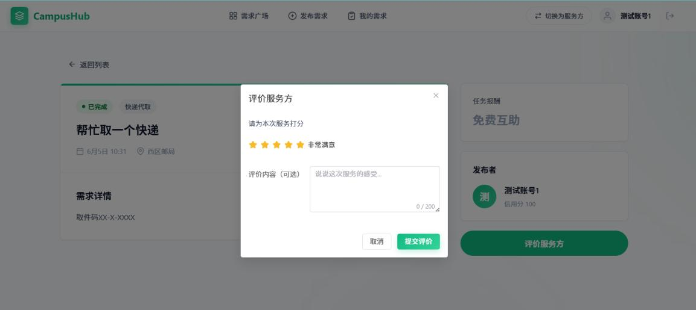

下面是通知功能演示，当被接单后，订单被确认完成后，评价完成后，对应的需求方，服务方，服务方会收到对应通知，主页面上方有铃铛可以看到通知：

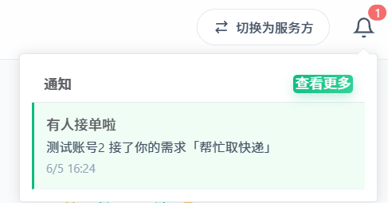

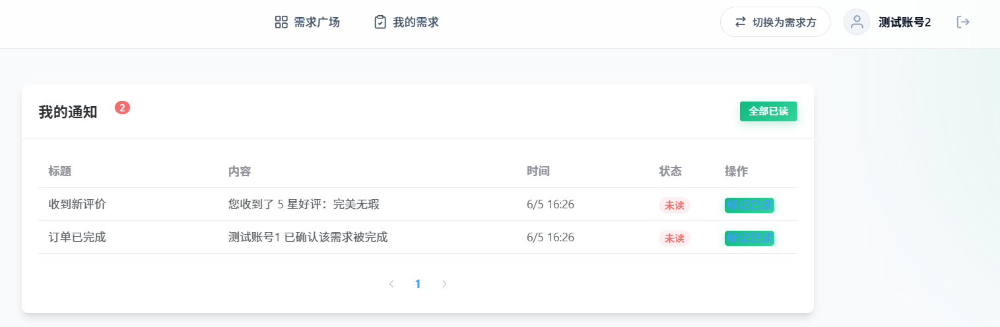

当订单被完成的时候，还可以进行投诉：

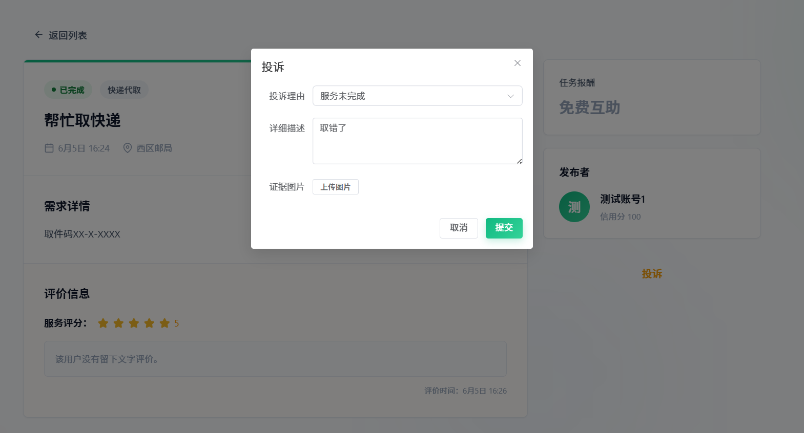

下面演示管理员相关的功能：

登录后如果是管理员账号，用户名左侧会有标识，可进入管理后台页面：

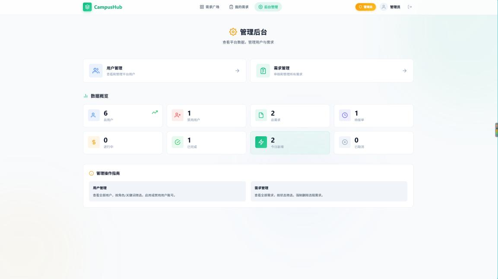

可查看相关信息，以及封禁用户和删除需求：

用户管理页面示例（真实账号信息已隐藏）：

| ID | 姓名 | 邮箱 | 手机号 | 角色 | 信用分 | 状态 | 操作 |
| --- | --- | --- | --- | --- | --- | --- | --- |
| 7 | 示例账号 | 示例邮箱 | 已脱敏 | 服务方 | 100 | 正常 | 禁用 |
| 6 | 已隐藏 | 已隐藏 | 已脱敏 | 需求方 | 100 | 正常 | 禁用 |
| 1 | 测试账号1 | 测试邮箱 | 已脱敏 | 需求方 | 100 | 正常 | 禁用 |
| 2 | 测试账号2 | 测试邮箱 | 已脱敏 | 服务方 | 101 | 正常 | 禁用 |
| 5 | 管理员 | 测试邮箱 | 已脱敏 | 管理员 | 100 | 禁用 | 启用 |
| 8 | 管理员 | 示例邮箱 | 已脱敏 | 管理员 | 100 | 正常 | 禁用 |

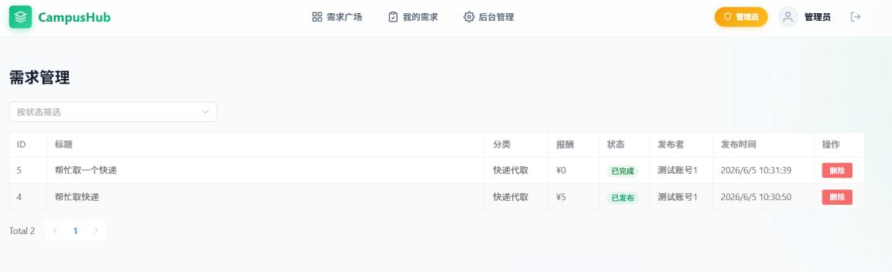

同时当订单被恶意破坏或者报酬未支付的时候，管理员会收到来自用户的投诉，如图所示：

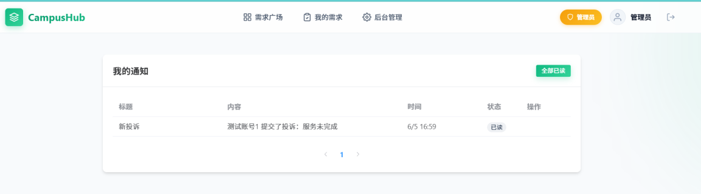
